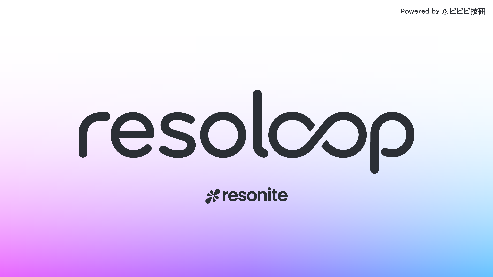

[English](README.md)｜[日本語](README_JA.md)

# resoloop

Imported content can be investigated offline with `resoloop bundle summary|tree|find|inspect|refs`. For example, `resoloop bundle find artifacts/worldroot-split --text EnemySpacing --json` searches saved member names/values, and `resoloop bundle refs artifacts/worldroot-split --key c000123 --direction in --json` traces recorded incoming references (replace the example key). `bundle collect-dependencies` saves bounded external observations without expanding edit ownership; `bundle extract` writes a source-backed analysis excerpt. See [offline analysis and dependency capture](docs/BUNDLE-ANALYSIS.md) for limits, session requirements and examples. These commands are included in version 0.1.0.



resoloop is a CLI for controlling Resonite worlds from AI agents such as Codex and Claude Code.

Tell the AI what you want to create, and it will inspect the current world, describe the Slot and Component structure in files, and apply and verify the result through ResoniteLink. Because the work is stored as files, you can apply the same structure repeatedly and track changes with Git.

resoloop automatically adds `FrooxEngine.AI_GeneratedContent` to the root of the content it generates and records the running tool's name and version in `Source` (for example, `[resoloop 0.1.0]`). The same tag is also added to portable and equippable roots within the declaration tree.

> [!NOTE]
> Version 0.1.0 is the first stable release and removes the preview designation. ResoniteLink remains in Beta.

After saving and reloading a world, resoloop preserves imported assets' `resdb:///` URLs when the state records the matching `$asset:` declarations. Older state files without `assetFields` stop before mutation with `APPLY_ASSET_MIGRATION_UNVERIFIED` if a saved URL cannot be verified. Inspect the asset, then explicitly set its verified saved URI as the manifest asset source (for example, `"source": "resdb:///…"`) and run `diff` again. Do not infer this mapping from a changed declaration or delete the state to bypass the check. Interrupted field writes invalidate their old asset evidence before the remote mutation; rerun the same manifest to converge.

If a saved Component ID disappears while the connection or observed Slot ID is unchanged and another same-type Component remains on that Slot, plan/apply stops with `STABLE_COMPONENT_AMBIGUOUS` before mutation. It never adopts that candidate by type or position. Preserve the checkpoint and verify the missing binding; after a deliberate removal, back up state and remove only the confirmed stale Component key so apply can create a new managed Component.

ResoniteLink cannot remove list elements. When a list member declared directly in `fields`, such as `MeshRenderer.Materials`, is shorter than the runtime list, `diff` shows `recreate`, and apply replaces the Component on the same Slot. Nested lists inside a syncObject are not recreated and are not guaranteed to converge when shortened. For direct list members, apply replaces the Component as follows: it creates the replacement with the declared fields, verifies the list, re-points managed references, and then removes the old Component without `--prune`. The replacement starts from `initialFields` and type defaults for undeclared members. Apply stops before mutation with `APPLY_LIST_SHRINK_REFERENCED` when something in the hierarchy apply read, other than a managed declared reference, points at the old Component, stops with `APPLY_LIST_SHRINK_NOT_CONVERGED` before deleting the old Component when the runtime keeps a replacement list longer (undoing only replacements it can safely remove), and stops before mutation with `APPLY_RECREATE_INTERRUPTED` when an interrupted recreate cannot resume in the same session. Follow that error's `recovery` and suggestions; an unchanged retry does not always converge. Before apply, `resoloop test` checks the currently existing Component even when `diff` plans a `recreate`.

## Installation

Requirements:

- Windows 10 or 11
- [`.NET 10 SDK`](https://dotnet.microsoft.com/download/dotnet/10.0)
- Resonite
- An AI coding agent such as Codex or Claude Code

Install from NuGet with the commands below. For local builds, follow the [local validation guide](docs/RELEASING.md#local-validation-before-publication).

Install resoloop in PowerShell:

~~~powershell
dotnet tool install --global ResoLoop --version 0.1.0
resoloop --version
~~~

If resoloop is already installed, update it with the following command:

~~~powershell
dotnet tool update --global ResoLoop --version 0.1.0
~~~

## Usage

### 1. Create a project

Create a dedicated project for each thing you want to build in Resonite.

~~~powershell
resoloop init MyResoniteProject
Set-Location MyResoniteProject
~~~

### 2. Configure ResoniteLink

1. Start Resonite and open the world you want to edit.
2. Open the `Settings` tab on the Dashboard's `Session` page.
3. Select `Enable ResoniteLink` in the lower-left corner.
4. Once `ResoniteLink running on port: ...` appears, ResoniteLink is ready.

The AI can then use resoloop to find the port and connect automatically.

You can also set the connection yourself using an environment variable, but this is optional.

For example, if the displayed port is `12449`:

~~~powershell
$env:RESONITE_LINK_URL="ws://localhost:12449"
resoloop doctor
~~~

The setup is complete when `ready` appears at the end.

### 3. Ask the AI to work on your project

Open the project you created in an AI agent. If you have continued using the same AI session since creating the project, reopen the session once so that the agent can discover the generated Skill.

Then describe what you want to build in Resonite using ordinary language. For example:

~~~text
Create a teleporter gun in Resonite. Make it an equippable item shaped like a gun. When fired, it should launch a projectile in an arc and teleport me to the point where the projectile lands.
~~~

## Blender modeling

When you ask for a complex model, resoloop may use Blender.

If Blender is installed on your PC, resoloop detects and uses it automatically.

You do not need to have Blender open.

## Efficient UIX authoring

UIX recipes provide reusable button, text-input, toggle, exclusive-choice, slider, shared-state, boolean binding and scroll-content structures. Choice/state bindings also compose tabs and open/closed panels. They leave shapes, colors, fonts, dimensions and feedback to the caller. Discover a recipe's parameters and connection points, then export it as a normal declaration prototype:

~~~powershell
resoloop uix recipe list --json
resoloop uix recipe describe button --json
resoloop uix recipe describe text-input --json
resoloop uix recipe export button --output content/recipes/button.json --json
resoloop diff content/main.json --brief --report artifacts/plan-01.json --json
resoloop apply content/main.json --brief --json
resoloop uix audit '$slot:panel' --state .resoloop/state/panel.json --brief --report artifacts/audit-01.json --json
~~~

For new content, declare `{"$recipe":"button","$with":{"key":"accept","rect":{}}}` directly in `children`; no include/export is needed. Generated keys use `uix-button--accept` as their prefix. Exported prototypes remain supported for pinned editable wiring; their existing keys do not change. See [Structural recipes](skills/codex/resonite-uix/references/recipes.md) for parameters and ports. Recipe export and reports require new filenames. `--brief` reduces displayed evidence, not validation: diff already performs offline and runtime checks, and apply repeats preflight against the current world. Standalone validate remains useful for offline authoring or diagnosis. Full reports preserve the existing JSON format.

Batch known managed fields with `resoloop observe '$member:state.Value' '$member:toggle.TargetValue' --state STATE --json`. This read-only command accepts up to 64 selectors and returns typed values and reference IDs, failing if any selected field is missing. It uses normal stable re-resolution after reconnect. Cross-Component values are sequential observations, not an atomic snapshot.

## Declaration and capture assistance

### Import existing content without changing the world

```powershell
resoloop import Root/WorldRoot --output artifacts/worldroot-import --url ws://localhost:PORT --command-timeout 600 --json
resoloop diff artifacts/worldroot-import/manifest.json --summary --profile --report artifacts/import-plan.json --json
# Optional: split a large observation into hashed groups sharing the same keys/state.
resoloop import Root/WorldRoot --output artifacts/worldroot-split --split-slots 256 --url ws://localhost:PORT --command-timeout 600 --json
```

`import` reads the exact subtree, Reflection and captured external dependency IDs. It writes a literal `origin: existing` manifest, an immutable `snapshot.json` containing all observed Slots/Components/members and type capabilities, `state.json` for edit baselines, and `report.json` for limitations. Names (including duplicate siblings), transforms, runtime values, unknown Components, external references and existing tags are preserved. Import never adds `AI_GeneratedContent`. Re-import requires a new directory and never overwrites prior edits or observations. Keep all four files together; this is an observation and management bundle, not a portable world/asset backup.

The initial `existing.changes` is empty: **diff reports zero changes even when runtime-owned values evolve**. To edit, find the exact Component key and baseline in `snapshot.json`, verify its current Reflection, and add only the desired fields to `manifest.json`, for example `"changes": { "c000042": { "Intensity": 2 } }` (replace the example key/member with the verified target). Run `diff` and review the one-field update before `apply`. Successful edits update local baselines; a concurrent world-side edit produces `IMPORT_EDIT_CONFLICT`. Interrupted writes can be retried with the same declaration; apply re-inspects each written value. Checks and writes are not atomic.

P1 also records reference edges and external dependencies in `snapshot.references`. Use `existing.referenceChanges[REFERENCE_KEY]` to select an imported `component`, `slot`, `member`, `slotMember` or `external` target (or `null` to disconnect). For example, `"referenceChanges": { "r000003": { "kind": "member", "key": "c000012", "path": [{"member":"Values"},{"index":1}] } }` selects a nested member; `{"kind":"external","key":"e000002"}` selects a captured dependency without owning or editing it. Replace example keys/paths with verified observations from this bundle. Paths use literal member names, indices or dictionary keys, never dotted-string parsing. New assignments require Reflection-proven type compatibility. Writes support direct references, partial SyncObjects and unchanged-length reference lists; list element IDs/order are verified, and unrelated references are preserved. Conflicts stop before mutation; opaque external targets can be retained but cannot be newly assigned. See [reference management and verification](docs/EXISTING-REFERENCES.md).

Use `existing.slotChanges` for explicit `Position`, `Rotation`, `Scale`, `IsActive`, `IsPersistent`, `Tag` and `OrderOffset` edits, for example `"slotChanges": { "s000042": { "Tag": "${0}:literal", "IsActive": false } }`. Transforms are local; Rotation is a normalized quaternion. Empty Tag text clears it (an unset runtime Tag may be null). Only requested attributes are sent, after baseline/current/desired checks; omitted runtime values are preserved. Name and Parent changes remain unsupported in this import workflow.

`--split-slots 256` writes a schema-3 snapshot index plus hashed files in `snapshot/`. Keys share one namespace across all parts, so forward references resolve without copying IDs. Optional `existing.editFiles` lists relative JSON files containing `schemaVersion: 1`, matching `ownershipKey` and `snapshotSha256`, and any `changes`, `referenceChanges` or `slotChanges`. Duplicate edits fail rather than overriding one another. Parts are literal, are bound to one import and use its single state; they are not independent imports. Keep the entire directory together. See [split bundles and Slot editing](docs/EXISTING-BUNDLES-SLOTS.md) for examples and verification.

Unsupported containers, events and unknown types remain observation-only. Existing imports cannot create, recreate, prune, move or auto-tag content. They require a matching world-session announcement (UDP discovery), fresh instance IDs, parent relationships and types. Changed sessions stop with `IMPORT_SESSION_CHANGED`; missing/ambiguous bindings are reported and edits to affected targets stop. No duplicate-name/ordinal fallback is used. Re-import after a world restart, and review any pending edits before transferring them; keys from different bundles are not interchangeable. P0 and single-file P1 snapshots remain readable. Imported state is dedicated to this workflow and is not a generated-content `--state` file for primitive stable selectors.

See [existing import contract and verification](docs/EXISTING-IMPORT.md) and [ResoniteLink issue drafts](docs/RESONITELINK-IMPORT-ISSUES.md).

New declarations can start from an offline structural scaffold. Inspect only the schema section you need; examples come from the parser DTOs. Provider scaffolds contain no visual settings.

~~~powershell
resoloop manifest scaffold --key panel --output content/panel.json --json
resoloop schema describe camera --json
resoloop manifest scaffold --kind provider --key front-material --type '[FrooxEngine]FrooxEngine.UI_UnlitMaterial' --output content/front.node.json --json
resoloop validate content/panel.json --json
# After appending the provider node, designing and applying the panel:
resoloop capture content/panel.json --frame '$slot:canvas' --view front --output artifacts/front.jpg --json
resoloop capture content/panel.json --frame '$slot:canvas' --view rear --output artifacts/rear.jpg --json
~~~

`--frame` requires the exact Slot containing one live planar Canvas, and uses its collider plus ancestor transforms. It preserves content scale; overflowing children, curved geometry, mirrored scales and occlusion require an explicit camera. `validate`/`diff` return conservative identity warnings for same-type Components sharing a Slot; separate named providers avoid this ambiguity for new content. See [authoring assistance](docs/AUTHORING-ASSISTANCE.md) for contracts and verification.

## Further documentation

Batch required Reflection metadata with `type query --request FILE.json --json`; obtain a request example from `schema describe reflection --json`. Explicit `members` select output; `enums` optionally adds candidate values. Persistent definitions are trusted when engine/link versions and adapter/Core builds match, with no default expiry. Local port changes do not invalidate them. Check, diff, apply and primitive conversion share this cache. `type check --request FILE.json --brief --json` checks contracts; `type check --manifest FILE.json --brief --json` reuses strict declaration validation. `--refresh` re-fetches definitions; `--cache off` bypasses disk reads/writes; `--cache-dir DIR` overrides storage. Refresh after MOD/DLL changes. Instance IDs, values and reference targets are still observed live. `--profile` includes request and cache counts. See [Reflection caching and measurements](docs/REFLECTION-EFFICIENCY.md).

- [Detailed documentation](README-DETAILS.md) — commands, architecture, declaration format, Flux-SDK, and limitations
- [Quick start](docs/QUICKSTART.md) — detailed steps including applying, verifying, and using ProtoFlux
- [Declaration format](docs/DECLARATIVE.md) — specification for `content/*.json`
- [UIX agent efficiency](docs/AGENT-EFFICIENCY.md) — implementation and measured before/after token usage
- [Control recipe efficiency](docs/CONTROL-RECIPE-EFFICIENCY.md) — expanded controls and a separate before/after benchmark
- [Authoring assistance efficiency](docs/AUTHORING-EFFICIENCY.md) — two runs per version measuring declaration, material-reference and capture assistance
- [Batched observation and direct recipes](docs/OBSERVATION-RECIPE-EFFICIENCY.md) — follow-up implementation, fixed-operation replay and independent authoring comparison
- [Roadmap](docs/ROADMAP.md)

## License

[AGPL-3.0-or-later](LICENSE)
